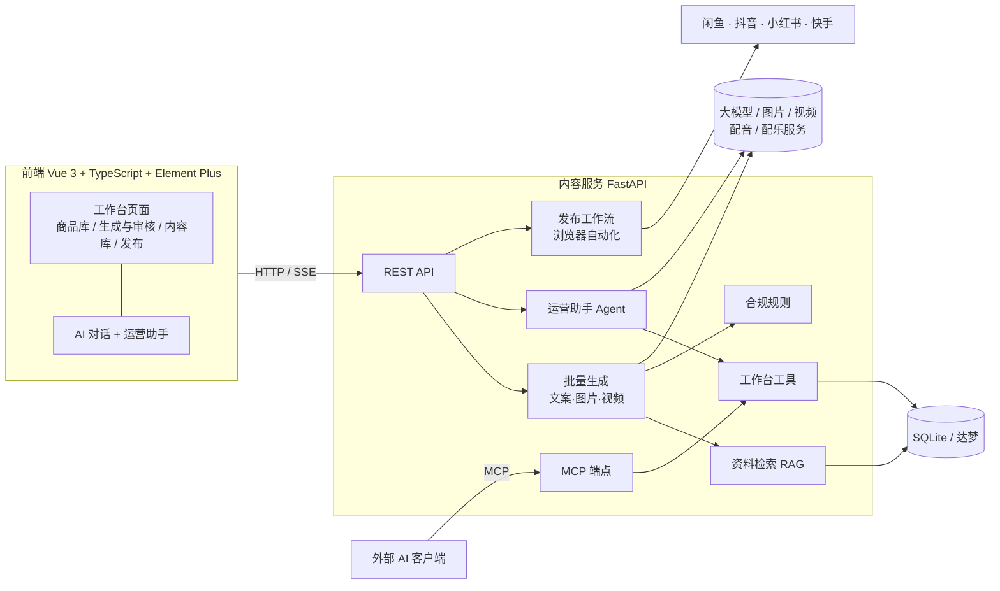

# 易发宝 · AI 商品内容生成与多平台发布工作台

易发宝把“一件商品”变成可以直接发布的多平台内容：在商品库录入商品后，AI 批量生成标题文案、宣传图片和宣传视频，人工审核通过后进入内容库，再一键分发到闲鱼（商品上架）以及抖音、小红书、快手（内容宣传）。适合需要在多个平台持续上新、又要守住广告法等合规要求的商家和运营人员，示例数据为白酒类商品。

- **人做决定，AI 干活**：选商品、审核、确认发布由人完成；检索资料、写文案、出图、剪视频、合规检测、填写发布表单由系统完成。
- **运营助手 Agent**：在 AI 对话里用一句话完成“查商品 → 发起生成 → 查进度 → 准备发布”，每一步实时可见。
- **可复用的工作流**：同一批内容可以反复分发到不同平台，每次执行都留下发布记录；结果不明的记录标为“待核查”，不会自动重试。

## AI 能力一览

| 能力 | 实现 | 代码位置 |
| --- | --- | --- |
| 大模型集成 | OpenAI 兼容接口，可配置文本、视觉、图片、视频、配音、配乐模型；主模型失败时自动切换备用模型；输出按 JSON 契约校验 | `chat_provider.py`、`llm_adapters.py`、`config.py` |
| Agent 工作流 | **运营助手**：先规划，再通过函数调用多轮执行 10 个工作台工具，计划、每一步的状态和结果实时推送到页面；审核和发布始终留给人确认 | `chat_agent.py`、`agent_tools.py`、`AgentTrace.vue` |
| RAG | 批量生成文案前，从资料库检索该商品的官方资料（宣传语、产品故事、工艺设计），只引用同一商品的内容，审核页展示参考来源；附对照评测 | `catalog_knowledge.py`、`automation_content.py`、[评测报告](backend/docs/rag-evaluation.md) |
| MCP / Function Calling | 对话先由模型通过函数调用在 5 个工具中选择（失败时回退规则）；工作台工具同时通过 **MCP 协议**（2025-06-18，Streamable HTTP + stdio 桥接）开放给外部 AI 客户端 | `chat_tools.py`、`mcp_server.py`、`backend/scripts/mcp_stdio.py` |
| 多模态 | 视觉模型识别商品图并分类；文生图 / 参考图生成宣传图；图生视频镜头 + FFmpeg 合成，含配音、配乐和字幕 | `automation_content.py`、`catalog_video.py`、`catalog_ai_video.py` |
| AI 安全与可控 | 广告法禁用词和敏感词规则拦截生成结果；资料、图片文字、对话内容一律按“数据而非指令”处理；生成结果必须人工审核；Agent 写操作需要权限且不能发布 | `catalog_routes.py`、`agent_tools.py` |
| AI 交互体验 | 对话回复 SSE 流式输出；生成图片、视频、文档时显示阶段；Agent 计划和步骤可视化；**语音输入**：浏览器自带语音识别实时转文字，可选服务端识别兜底 | `chat_live.py`、`ContentChatView.vue`、`voiceInput.ts`、`speech_input.py` |

### RAG 效果评测

`backend/scripts/rag_eval.py` 用真实模型对同一批商品各生成两次文案（输入完全相同，唯一区别是是否附带检索到的资料），统计文案用到了多少官方资料里的独特细节、是否出现资料中没有的编造数字，并让模型在不知道哪一版用了检索的情况下盲评。结果见 [backend/docs/rag-evaluation.md](backend/docs/rag-evaluation.md)：

| 指标（随机抽取 10 个商品，文本模型 chat-max） | 不检索 | 检索增强 |
| --- | --- | --- |
| 用到的官方资料独特细节（共 552 条可用） | 12 | **134** |
| 资料中没有的数字 | 1 | 1 |
| 盲评“具体度与辨识度”胜出 | 0 | **10** |
| 盲评“事实准确”胜出 | 0 | **10** |

检索后文案写出了大量商品独有的宣传语、产品故事和设计细节，而没有多出编造的数据。两组各 1 个“资料中没有的数字”都是模型从商品图瓶身读到的“100ml”，并主动指出它与商品信息“500ml×6”不一致，不是编造。

## 系统架构



- `frontend/`：Vue 3 + TypeScript + Element Plus。工作台页面按需加载，打开工作台所需脚本从 1490 KB 降到 561 KB（gzip）。
- `backend/services/content_service/`：FastAPI 内容服务（端口 8002），SQLAlchemy + Alembic 迁移，默认 SQLite，可切换达梦数据库；资料检索可接入 WeKnora。
- `launcher/`：Windows 一键启动器，检查依赖和端口后启动前后端。

主流程：「商品库」维护商品（名称、价格、1–9 张图片、参数）→ 勾选一批商品「批量生成」，可选标题和文案、宣传图片、宣传视频 →「生成与审核」由管理员通过、驳回、修改或按意见重新生成 → 通过后写入「内容库」→「商品上架」（闲鱼）和「内容宣传」（抖音、小红书、快手）两个独立工作流从内容库选取内容执行 → 每次执行都写入「发布记录」。「内容宣传」会按三个平台发布页的样子预览标题、正文和视频，并标红超出平台字数限制的部分。

## 安装与运行

| 组件 | 端口 |
|---|---|
| 前端 | 8200 |
| 内容 API | 8002 |

1. 在 `backend` 创建 Python 3.12 虚拟环境并安装 `requirements-dev.txt`，复制 `backend/.env.example` 为 `backend/.env`，填写模型接口地址和密钥（也可以启动后在“模型与服务”页面里设置）。
2. 在 `frontend` 安装依赖：

   ```powershell
   pnpm install --store-dir ../.pnpm-store --frozen-lockfile --prefer-offline --ignore-scripts --registry=https://registry.npmjs.org
   pnpm rebuild esbuild @swc/core vue-demi
   ```

3. 运行 `launcher/start.ps1`（或编译后的启动器 EXE），打开 http://127.0.0.1:8200/content/ 。

本机工作台无需登录，前后端只监听本机回环地址。启动前会检查依赖、Vite 配置和端口归属；缺失依赖时直接报错，不会先启动一半服务。在“模型与服务”中点击“修改模型”，可设置文本、图片、视频、配音和背景音乐服务；已有密钥不会回显。

可选开关（`backend/.env`）：`CONTENT_CHAT_STREAMING`（流式回复）、`CONTENT_CHAT_TOOL_ROUTING`（函数调用选工具）、`CONTENT_CATALOG_RAG`（批量生成时检索资料），默认都开启。达梦数据库与 WeKnora 知识平台的配置项见 `backend/.env.example`。

### 通过 MCP 使用工作台

工作台运行时，支持 MCP 的客户端可以直接连接 `http://127.0.0.1:8002/api/v1/mcp`（Streamable HTTP）。只支持本地进程方式的客户端（如桌面版 AI 助手）使用 stdio 桥接：

```json
{
  "mcpServers": {
    "yifabao": {
      "command": "<项目目录>/backend/.venv/Scripts/python.exe",
      "args": ["<项目目录>/backend/scripts/mcp_stdio.py"]
    }
  }
}
```

可用工具：`workbench_overview`、`search_products`、`list_review_items`、`list_contents`、`list_publish_records`、`search_knowledge`、`check_compliance`、`start_generation`、`regenerate_item`、`prepare_publish`。

## 测试

```powershell
cd backend; .\.venv\Scripts\python.exe -m pytest -q tests
cd frontend; node --test scripts/*.test.mjs
```

运营助手、MCP 和 RAG 的测试分别在 `backend/tests/test_chat_agent.py`、`test_mcp_server.py`、`test_catalog_rag.py`，用脚本化的假模型覆盖规划、工具调用、失败保留、权限和发布边界。

## 团队信息

广东东软学院 · 勇敢牛牛，不怕困难

## 开源声明

前端宿主外壳（项目脚手架、构建配置、布局与通用组件）基于 MIT 协议的开源项目 [yudao-ui-admin-vue3](https://gitee.com/yudaocode/yudao-ui-admin-vue3)（芋道源码，其本身源自 [vue-element-plus-admin](https://github.com/kailong321200875/vue-element-plus-admin)），原版权声明保留在 [frontend/LICENSE](frontend/LICENSE)。本作品的业务功能为自行开发：前端位于 `frontend/src/views/agent/` 与 `frontend/src/api/agent/`，后端内容服务位于 `backend/services/content_service/`。第三方依赖的许可证见 [frontend/dependency-licenses.txt](frontend/dependency-licenses.txt) 及 `backend/requirements*.txt`。
